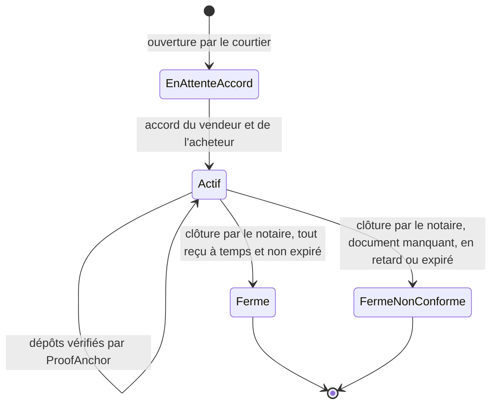

# Proposition de simplification

Projet MGL850 : protocole ouvert de preuves immobilières
Proposition de Marc, à valider en équipe (Cedric, Alex).

Les composants sont décrits dans [ARCHITECTURE.md](ARCHITECTURE.md), le flow complet dans [Flow_transaction_immobiliere_blockchain.md](Flow_transaction_immobiliere_blockchain.md) et le partage du travail dans [REPARTITION.md](REPARTITION.md).

---

## 1. Pourquoi simplifier

Le projet a beaucoup grandi depuis la proposition : 9 composants, 4 contrats, 2 registres, un pont, 5 standards. C'est un projet d'étude. Il doit **démontrer les idées clés**, pas livrer un produit.

**Principe :** on code le noyau qui répond aux questions de départ. Tout le reste va dans la section « Limites et pistes » du rapport, avec la raison du choix. Le professeur voit ainsi qu'on a compris ces sujets, sans qu'on ait à les coder.

Les questions de départ :

1. **Origine** : le document vient-il vraiment de l'émetteur indiqué ?
2. **Validité actuelle** : a-t-il été annulé depuis ?
3. **Validité historique** : était-il valide le jour de la signature de la promesse ?
4. **Dossier** : les bons documents sont-ils arrivés à temps, venant des bons émetteurs ?

---

## 2. Ce qu'on garde, simplifie ou reporte

| Sujet | Garder | Simplifier en | Reporter au rapport |
| --- | --- | --- | --- |
| Empreinte | Empreinte du PDF avec **sel** | | |
| Lots et arbre de Merkle | Arbre, racine, preuve d'inclusion | | Tests de charge jusqu'à 1 million de documents |
| ProofAnchor (C3) | `anchor` et `wasValidAt` | | |
| Annulation | Chemin **normal** (nouveau lot) | | Annulation urgente, date de compromission rétroactive |
| Émetteurs autorisés (C7) | | Liste gérée par **un administrateur**, avec dates d'ajout et de retrait | Vote multisig 2 sur 3 des organismes |
| Deux registres | | **Une seule chaîne** Hardhat locale (question 2 posée à l'enseignant, réponse à noter) | Double écriture sur 2 chaînes, RootMirror, Hyperlane ou CCIP, OpenTimestamps, testnets publics |
| Dossier de vente (C6) | Ouverture, accord des 2 parties, dépôt vérifié, marque « à temps » ou « en retard », clôture | Document manquant, en retard ou expiré : clôture **« non conforme », décidée par le contrat** (le notaire choisit seulement le moment) | Prolongation de délai |
| Conditions de la promesse | | Aucune condition codée : le dépôt du rapport d'inspection suffit (D12) | Inspection « réalisée » ou « levée », financement, caducité automatique |
| Surveillant des délais et avis (C6-a, C6-b) | | Retirés du prototype (D12). Extension prévue : avis d'expiration | `checkUpkeep`, `performUpkeep`, Chainlink Automation, courriel et SMS |
| Passerelle partenaires (C5) | | | Supprimée : l'interface web suffit |
| Standards | | Reçu de preuve en **JSON simple**, inspiré de W3C VC 2.0 | Suite de tests W3C, did:pkh, CAIP-2 / CAIP-10, Bitstring Status List |
| Site de vérification (C4) | PDF glissé, empreinte calculée dans le navigateur, appel à `wasValidAt` | | |

---

## 3. Ce qui a été construit

| Élément | Type | Contenu |
| --- | --- | --- |
| **ProofAnchor** | Contrat | Racines des lots avec leur date, `wasValidAt`, liste des émetteurs avec dates d'ajout et de retrait, signature de l'émetteur |
| **TransactionWorkflow** | Contrat | Dossier de vente : ouverture, accord des 2 parties, dépôts vérifiés par ProofAnchor, clôture conforme ou non décidée par le contrat |
| **Scripts** | Console | Déployer, émettre et annuler, sceller un lot, vérifier, suivre un dossier, avancer l'horloge, enregistrer les vidéos de démo |
| **Plateforme web** | Navigateur | Vérification d'un PDF à une date, écrans du dossier pour le courtier, le vendeur, l'acheteur et le notaire (voir WEB.md et adr/) |

Retirés en cours de route : deuxième chaîne, condition d'inspection, rappels et surveillant des délais (D12), page de l'émetteur (l'émission se fait en console).

### Documents couverts

La simplification ne retire aucun document. Elle retire seulement la *condition* de financement : l'engagement hypothécaire reste un document demandé au dossier.

**Couverts dans le prototype :** ce sont les documents émis par un tiers et soumis à un délai, le cas que le protocole veut résoudre.

| Document | Émetteur | Qui le dépose | Délai (démo) | Pourquoi il est essentiel |
| --- | --- | --- | --- | --- |
| Rapport d'inspection | Inspecteur | Acheteur | 10 jours | Condition de la promesse |
| Engagement hypothécaire | Prêteur | Acheteur | 14 jours | Financement de l'achat |
| Attestation du syndicat | Syndicat de copropriété | Vendeur | 15 jours | Obligatoire en copropriété (art. 1068.1 C.c.Q.) |
| Certificat de localisation | Arpenteur-géomètre | Vendeur | 30 jours | Exigé par le notaire et le prêteur |

**Faciles à ajouter, sans modifier les contrats :** la liste des documents est une donnée du dossier, pas du code. Il suffit d'ajouter un type d'émetteur et une ligne au dossier.

| Document | Émetteur |
| --- | --- |
| Déclarations du vendeur (formulaire OACIQ) | Vendeur |
| Certificat de taxes municipales et scolaires | Municipalité, centre de services scolaire |
| Preuve d'assurance habitation | Assureur |
| Rapport d'évaluation | Évaluateur, pour le prêteur |
| Étude du fonds de prévoyance, carnet d'entretien | Syndicat de copropriété |

**Hors périmètre :**

- **Promesse d'achat et acte de vente** : signés par les parties ou le notaire, ce ne sont pas des documents émis par un tiers. Le dossier les représente déjà par sa date d'ouverture et par sa clôture.
- **Titre de propriété et registre foncier** : déjà publics et officiels. Le protocole n'y ajoute rien.

### États du dossier simplifiés

Sans la transition `Actif → FermeNonConforme`, un seul document en retard bloquerait le dossier pour toujours dans l'état `Actif`. Le notaire choisit le moment de la clôture, mais c'est le contrat qui décide entre `Ferme` et `FermeNonConforme` : le notaire ne peut pas déclarer conforme un dossier qui ne l'est pas.

---

## 4. Le flow nominal à démontrer

1. **Reconnaître l'émetteur** : l'administrateur ajoute l'inspecteur à la liste des émetteurs autorisés.
2. **Ouvrir le dossier** : le courtier ouvre le dossier. Le vendeur et l'acheteur l'approuvent.
3. **Émettre le document** : l'inspecteur émet le rapport. Empreinte, puis lot, puis racine scellée sur la chaîne.
4. **Déposer** : l'acheteur dépose le rapport, accepté « à temps ». Un rapport modifié d'un octet est refusé.
5. **Vérifier et fermer** : le notaire vérifie le rapport sur la page de vérification, puis ferme le dossier.
6. **Annuler (démo bonus)** : l'inspecteur annule le rapport. Il était valide le jour de la signature et ne l'est plus aujourd'hui.

**Scénarios de refus à montrer :** document jamais scellé, émetteur non reconnu, dépôt par la mauvaise personne.

---

## 5. Décisions prises pendant la revue

| # | Décision | Raison |
| --- | --- | --- |
| D1 | Dire **« lot d'ancrage »** (*batch*) plutôt qu'« époque ». `epochId` peut rester dans le code | En Ethereum, *epoch* désigne déjà un groupe de 32 blocs. Risque de confusion |
| D2 | **Saler** les empreintes. Le sel est remis avec le document, dans le reçu | Sans sel, quelqu'un qui possède une copie du PDF peut le retrouver sur le registre public |
| D3 | `wasValidAt` vérifie que le lot fourni était **en vigueur** à la date demandée : scellé avant la date, et le lot suivant scellé après | Empêche de présenter une vieille preuve après une annulation |
| D4 | La liste des émetteurs garde les **dates** d'ajout et de retrait | Retirer un émetteur ne doit pas invalider ses documents honnêtes déjà émis |
| D5 | Un document en retard permet une **clôture non conforme** par le notaire | Sinon, le dossier reste bloqué pour toujours |
| D6 | Le sel est dans le **reçu** remis avec le PDF, et l'émetteur en garde une **copie** dans son registre | Sans le sel, plus aucune preuve n'est possible. Une fuite du sel touche la confidentialité, pas l'intégrité |
| D7 | L'émetteur **signe** (empreinte, statut, dateStatut, dateExpiration) avec sa clé (EIP-191). La signature est dans le reçu et `wasValidAt` la vérifie | C'est le service de scellement qui remplit le champ émetteur. Sans signature, un service piraté pourrait inventer un document au nom d'un émetteur reconnu |
| D8 | `wasValidAt` vérifie que l'émetteur était reconnu **à la date `dateStatut`** (signée), et que `dateStatut` n'est pas après la date demandée. Le service de scellement refuse un nouveau document antidaté ou venant d'un émetteur retiré | Applique D4 : un retrait n'invalide pas les documents émis avant. Le contrat ne peut pas détecter un `dateStatut` antidaté, car un lot est une photo complète |
| D9 | Les périodes sont **fermées au début et ouvertes à la fin** : `ajout ≤ date < retrait`, `scellement ≤ date < scellement suivant` | À chaque seconde, un seul lot est en vigueur. Au moment exact d'un retrait, l'émetteur n'est déjà plus reconnu |
| D10 | Le reçu contient le sel, les champs de la feuille, la signature, l'adresse du contrat et la chaîne. La **preuve** n'y est pas figée : le service publie les feuilles de chaque lot, et la page de vérification recalcule la preuve | La preuve change à chaque lot. Les feuilles publiées ne révèlent rien, car les empreintes sont salées (D2). Un faux fichier de feuilles donne une autre racine et ne peut faire accepter aucun faux document |
| D11 | La feuille contient une **date d'expiration** juridique, fixée et signée par l'émetteur (`0` : aucune). `wasValidAt` refuse à partir de cette date. Pas de champ de texte libre dans la feuille | Un document expiré devient invalide sans annulation ni nouveau lot. Un texte libre serait lisible par tous dans les fichiers publics des lots |
| D12 | **Dossier de vente minimal** : accord du vendeur et de l'acheteur, liste des documents attendus, dépôt vérifié par `wasValidAt`, clôture `Ferme` si tout est arrivé à temps et non expiré, sinon `FermeNonConforme`. La date d'expiration est mémorisée au dépôt et contrôlée à la clôture. Condition d'inspection et rappels retirés | Répond à la question 4 (bons documents, à temps, bons émetteurs) avec le moins de code. L'accord des parties empêche un courtier de choisir seul l'acheteur. Les avis sont une extension |
| D13 | **Une seule feuille par document dans un lot, et ANNULE est définitif.** Chaque lot recopie l'état actuel de tous les documents. Un document annulé ne redevient jamais valide : pour corriger, l'émetteur émet un nouveau document avec un nouveau sel | Avec deux feuilles (VALIDE et ANNULE), le porteur présenterait la feuille VALIDE et `wasValidAt` répondrait vrai. La règle évite aussi de départager deux lignes qui ont la même `dateStatut`. Une annulation par erreur ne peut pas être défaite |
| D14 | **Type du document et immeuble dans la feuille signée.** `typeDocument` (1 inspection, 2 attestation du syndicat) et `immeuble = keccak256(cadastre, selImmeuble)`. Le courtier crée le sel de l'immeuble et le remet à l'émetteur et au notaire. ProofAnchor les signe et les scelle sans les juger. TransactionWorkflow les compare à ce que le dossier attend | Sans eux, un vrai rapport d'une autre maison serait accepté au dépôt. Le sel est nécessaire : le fichier du lot est public et un cadastre non salé se devine en essayant tous les numéros. Réponse de l'enseignant à la question 5 : des métadonnées, sans complexifier. Prix : un sel de plus à transmettre hors chaîne |

---

## 6. À mettre dans le rapport (limites et pistes)

Ces sujets ont été analysés mais ne sont pas codés :

- **Fenêtre d'annulation** : avec le chemin normal, un document annulé reste « valide » jusqu'au prochain lot. Une annulation urgente la fermerait, mais elle publie l'empreinte seule et ajoute une 2e source de vérité.
- **Clé d'émetteur volée** : les faux documents émis entre le vol et le retrait restent valides. Une date de compromission rétroactive corrigerait ce problème, mais la réponse de `wasValidAt` changerait alors avec le temps.
- **Service de scellement piraté** : grâce à la signature (D7), il ne peut plus inventer un document. Il peut encore cacher une annulation en remettant l'ancienne feuille « valide », dont la signature est authentique (rejeu). Il faudrait que l'émetteur signe chaque lot.
- **Panne du service de scellement** : aucun lot n'est scellé pendant la panne. La fenêtre d'annulation s'allonge d'autant, et on ne peut pas antidater un lot.
- **Véracité du contenu** : le système prouve l'origine, l'intégrité et la date d'un document, pas que son contenu est vrai. L'émetteur joue le rôle d'un oracle (« garbage in, garbage out »). La confiance repose sur les institutions (permis, ordre professionnel, responsabilité). La signature empêche seulement l'émetteur de nier ce qu'il a émis.
- **Date d'expiration** : elle est fixée par l'émetteur, sans contrôle. Une durée maximale par type de document, fixée par l'administrateur, empêcherait une durée abusive. Les durées juridiques réelles sont à valider avec un notaire.
- **Taille des fichiers de lots** : chaque lot recopie tous les documents jamais émis (D13), même annulés ou expirés, et les anciens fichiers restent nécessaires pour vérifier une date passée. La chaîne n'est pas touchée (une racine de 32 octets par lot, une preuve de 20 hash pour un million de documents), mais le stockage hors chaîne croît sans fin. Ordre de grandeur, à partir d'hypothèses à vérifier (100 000 ventes par an, 2 documents par vente, environ 500 octets par feuille, un lot par jour) : environ 100 Mo par fichier et 18 Go d'historique après un an, 500 Mo et 450 Go après cinq ans. Piste : ne plus recopier un document annulé ou expiré dans le lot suivant. C'est sans risque grâce à D3 (seul le lot en vigueur compte), à condition que le service garde la liste des empreintes annulées pour faire respecter D13. Les documents sans expiration resteraient. Autres pistes : fichiers compressés, preuves servies une à une, copies sur IPFS. Les mesures de 10 à 10⁶ documents (PLAN.md) donneront les chiffres réels.
- **Émetteur fixé à l'ouverture du dossier** : le courtier doit connaître l'inspecteur dès l'ouverture, alors qu'en pratique l'acheteur le choisit souvent après. Ce choix ferme un trou : ProofAnchor ne lie pas un type de document à un émetteur, donc le syndicat pourrait signer un document de type inspection. Piste : le registre des émetteurs associe à chacun les types qu'il peut émettre.
- **Annulation après le dépôt** : le dossier vérifie un document au moment du dépôt seulement. Une annulation plus tardive n'est pas vue à la clôture. Le notaire revérifie avec la page de vérification avant de fermer. Piste : exiger une nouvelle preuve à la clôture.
- **Comptes de test à la place d'un portefeuille** : dans la plateforme web, la chaîne Hardhat signe pour les comptes de test choisis dans le menu « Je suis ». Personne ne partage ses clés dans la réalité. Piste : MetaMask (ADR 0004).
- **Fichiers des lots servis par un seul serveur** : s'il tombe, plus aucune preuve ne peut être calculée, même si les racines restent sur la chaîne. Piste : copies répliquées (IPFS, miroirs).
- **Registre de l'immeuble simulé** : le cadastre et son sel sont gardés par le serveur des pages, alors qu'ils devraient être dans le logiciel privé du courtier (ADR 0001).
- **Administrateur unique** des émetteurs : un seul point de confiance et de défaillance. Un vote multisig des organismes de confiance (OACIQ, Chambre des notaires) réglerait ce problème.
- **Équivoque du service de lots** : s'il est piraté, il peut envoyer une racine différente à chaque chaîne. Une copie relayée (RootMirror) ou un pont (Hyperlane, CCIP) permettrait de le détecter.
- **Une seule chaîne** : si elle tombe, ni la vérification ni le dossier de vente ne fonctionnent. Une deuxième chaîne avec double écriture des racines permettrait de continuer à vérifier.
- **Confidentialité du dossier** : les délais, la liste des documents et les adresses des parties sont publics. Pseudonyme ne veut pas dire anonyme.
- **Portefeuilles et frais** : vendeur et acheteur doivent avoir un portefeuille et payer des frais de transaction (gaz). C'est un frein à l'adoption.
- **Valeur juridique** : une preuve sur le registre n'est pas un acte notarié. Les délais et les règles de caducité sont à valider avec un notaire.

---

## 7. À valider en équipe

- [ ] Cedric : liste d'émetteurs simple au lieu du vote 2 sur 3. RootMirror et pont reportés au rapport
- [ ] Alex : reçu JSON simple au lieu de la suite W3C complète. did:pkh et CAIP reportés
- [ ] Tous : suppression de C5, une seule condition, script Node.js à la place de Chainlink
- [ ] Tous : décisions D1 à D5
